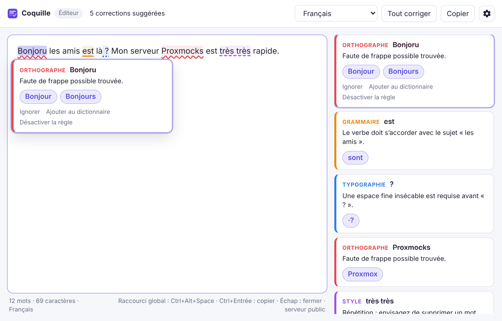

# Coquille

**Correcteur d'orthographe, de grammaire et de typographie pour Linux, Windows et macOS.** Il fonctionne dans toutes les applications : tu sélectionnes du texte, tu appuies sur un raccourci, tu corriges, et le texte corrigé remplace ta sélection.



- Fonctionne **dans n'importe quelle application** : navigateur, Discord, Word, LibreOffice, VS Code, client mail…
- **Éditeur intégré** avec vérification pendant la frappe, fautes soulignées par type (orthographe, grammaire, typographie, style).
- Suggestions en un clic, **Tout corriger**, annulation avec Ctrl+Z, dictionnaire personnel, règles désactivables.
- Moteur **[LanguageTool](https://languagetool.org)** : le serveur public, ou **ton propre serveur** (Docker sur Proxmox, accès via Tailscale).
- Binaire léger (≈ 6 Mo sous Linux) grâce à [Tauri](https://tauri.app) (Rust + WebView du système).

## Est-ce de l'IA ?

Non, pas au sens « ChatGPT ». LanguageTool est un moteur **à règles** : plusieurs milliers de règles grammaticales écrites par des linguistes, un dictionnaire orthographique et, en option, des statistiques de fréquence de mots (les « n-grammes »). C'est la même famille de technologie que le cœur d'**Antidote** (analyse linguistique symbolique). **QuillBot**, lui, repose surtout sur des modèles d'IA, en particulier pour la reformulation.

Conséquences :

- les corrections sont **déterministes** et chaque remarque explique la règle appliquée ;
- tout tourne **en local** si tu héberges le serveur, sans GPU ;
- en revanche, Coquille ne **reformule** pas des phrases entières comme QuillBot. Une fonction de reformulation par IA (Ollama sur ton Proxmox, par exemple) peut s'ajouter plus tard.

## Fonctionnement

```
 Application quelconque          Coquille (barre système)            LanguageTool
 ┌──────────────────────┐  raccourci  ┌──────────────────────┐  HTTP  ┌──────────────────┐
 │ texte sélectionné    │ ──────────▶ │ capture la sélection │ ─────▶ │ /v2/check        │
 │                      │             │ affiche les fautes   │ ◀───── │ (public ou ton   │
 │ texte corrigé ◀──────┼─ Ctrl+Entrée│ recolle le résultat  │        │  serveur Docker) │
 └──────────────────────┘             └──────────────────────┘        └──────────────────┘
```

| Système | Lecture de la sélection | Remplacement |
|---------|-------------------------|--------------|
| Linux X11 | sélection primaire (texte surligné), presse-papiers intact | Ctrl+V simulé |
| Linux Wayland | `wl-paste --primary` | `wl-copy` + `wtype` ou `ydotool` |
| Windows | Ctrl+C simulé, puis restauration du presse-papiers | Ctrl+V simulé, puis restauration |
| macOS | Cmd+C simulé, puis restauration du presse-papiers | Cmd+V simulé, puis restauration |

## Installation

### Arch Linux

```bash
git clone https://github.com/MathieuRDG/test-claude.git coquille
```

```bash
cd coquille/packaging/arch
```

```bash
makepkg -si
```

Sous **Wayland**, installe aussi les outils de presse-papiers et de frappe :

```bash
sudo pacman -S wl-clipboard wtype
```

- `wl-clipboard` est obligatoire sous Wayland.
- `wtype` fonctionne sous Hyprland, Sway et les autres compositeurs wlroots.
- Sous KDE Plasma ou GNOME, `wtype` n'est pas pris en charge : utilise `ydotool` (démon `ydotoold` requis, voir le wiki Arch) ou colle toi-même avec Ctrl+V. Coquille te prévient si le collage automatique est impossible.

Une **AppImage** et des paquets `.deb`/`.rpm` sont aussi produits par la CI (voir « Compilation »).

### Windows

Récupère le `.msi` ou le `-setup.exe` dans les *Releases*. Le binaire n'est pas signé : SmartScreen affiche « Windows a protégé votre ordinateur ». Clique sur **Informations complémentaires**, puis **Exécuter quand même**.

### macOS

Récupère le `.dmg` (`aarch64` pour Apple Silicon, `x64` pour Intel). L'application n'est pas signée par Apple, alors au premier lancement fais clic droit › **Ouvrir**, ou exécute :

```bash
xattr -dr com.apple.quarantine /Applications/Coquille.app
```

Au premier raccourci, macOS demande l'autorisation **Accessibilité** (Réglages Système › Confidentialité et sécurité › Accessibilité). Elle est nécessaire pour simuler Cmd+C et Cmd+V. Relance Coquille après l'avoir accordée.

## Utilisation

1. Sélectionne du texte dans n'importe quelle application.
2. Appuie sur le raccourci : **Ctrl+Alt+Espace** (Windows, Linux X11) ou **⌘+Maj+Espace** (macOS). Il se modifie dans ⚙.
3. Corrige : clique sur un mot souligné ou sur une carte à droite, puis sur une suggestion. **Tout corriger** applique la première suggestion de chaque faute, sauf les remarques de style.
4. Appuie sur **Ctrl+Entrée** (⌘+Entrée) ou sur **Remplacer** : la fenêtre se masque et le texte corrigé remplace ta sélection.

Échap ferme la fenêtre. Coquille reste dans la barre système ; un clic sur l'icône ouvre l'éditeur.

### Raccourci sous Wayland (Hyprland, KDE, GNOME, Sway)

Sous Wayland, une application ne peut pas intercepter un raccourci global. Associe donc la commande `coquille --corriger` à une touche dans ton bureau. Si Coquille tourne déjà, la commande réveille l'instance existante.

```ini
# Hyprland (~/.config/hypr/hyprland.conf)
bind = CTRL ALT, space, exec, coquille --corriger
# Fenêtre flottante et centrée (facultatif)
windowrulev2 = float, class:^(coquille)$
windowrulev2 = size 1000 640, class:^(coquille)$
windowrulev2 = center, class:^(coquille)$
```

- **KDE Plasma** : Configuration du système › Clavier › Raccourcis › Ajouter un nouveau › Commande ou script.
- **GNOME** : Paramètres › Clavier › Raccourcis personnalisés.
- **Sway** : `bindsym Ctrl+Alt+space exec coquille --corriger`

Autres options de ligne de commande : `--cache` (démarrer en arrière-plan) et `--parametres` (ouvrir les réglages).

## Serveur LanguageTool

Par défaut, Coquille utilise `https://api.languagetool.org`, gratuit mais limité en requêtes par minute et en taille de texte. Pour un usage quotidien, héberge ton serveur : un `docker compose up -d` suffit, et les instructions pour **Proxmox (LXC) + Tailscale** sont dans **[server/README.md](server/README.md)**. Saisis ensuite son adresse dans ⚙ › Serveur LanguageTool, puis clique sur **Tester**.

Avec ton serveur, tu peux aussi brancher l'**extension navigateur officielle LanguageTool** dessus. Tu obtiens alors la correction **en direct pendant la frappe** dans Gmail, les formulaires web, etc. (voir la section « Bonus » du README du serveur).

## Limites connues

- **Pas de soulignement en direct dans toutes les applications.** Grammarly y consacre des années de développement (API d'accessibilité spécifiques à chaque OS et application), et Wayland l'interdit tout bonnement. Coquille passe donc par un raccourci et une fenêtre, comme le correcteur d'Antidote. Pour le direct dans le navigateur, utilise l'extension LanguageTool branchée sur ton serveur.
- **Terminaux** : ils collent avec Ctrl+Maj+V, donc le remplacement automatique n'y fonctionne pas. Utilise **Copier**.
- **Presse-papiers** : seul son contenu *texte* est restauré après un remplacement. Une image copiée juste avant serait perdue.
- **Windows et macOS** : le code se compile pour ces deux cibles, mais il n'a été exécuté que sous Linux (X11 et Wayland). Remonte-moi tout comportement anormal.

## Dépannage

| Problème | Solution |
|----------|----------|
| Fenêtre blanche (Linux, NVIDIA) | Déjà contourné (`WEBKIT_DISABLE_DMABUF_RENDERER=1`). Sinon, essaie `GDK_BACKEND=x11 coquille`. |
| « Raccourci refusé » | Une autre application l'utilise déjà : choisis-en un autre dans ⚙. |
| « Aucun texte sélectionné » (Wayland) | Vérifie que `wl-paste --primary` affiche bien ta sélection dans un terminal. |
| « Serveur injoignable » | Teste l'adresse dans ⚙, puis vérifie Tailscale et `docker compose ps` sur le serveur. |
| Code 429 | Le serveur public te limite : passe sur ton propre serveur. |
| Pas d'icône dans la barre (GNOME) | Installe l'extension *AppIndicator and KStatusNotifierItem Support*, ou relance `coquille` pour rouvrir la fenêtre. |

La configuration est stockée dans `~/.config/org.coquille.correcteur/config.json` (Linux), `%APPDATA%\org.coquille.correcteur\` (Windows) ou `~/Library/Application Support/org.coquille.correcteur/` (macOS).

## Compilation

Prérequis : Rust stable et Node 18+. Sous Arch : `webkit2gtk-4.1 libayatana-appindicator`.

```bash
npm ci
```

```bash
npm run build
```

Ou, sans Node :

```bash
cd src-tauri && cargo build --release
```

Tests :

```bash
cd src-tauri && cargo test
```

```bash
npm run test:ui
```

**Installateurs Windows, macOS et Linux** : pousse un tag `v0.1.0` sur GitHub. Le workflow `.github/workflows/release.yml` compile sur les trois OS et crée un brouillon de release avec les installateurs.

### Structure

```
src/                 Interface (HTML/CSS/JS sans framework)
src-tauri/src/
  main.rs            Fenêtre, icône système, raccourci global, commandes
  langtool.rs        Client de l'API LanguageTool (/v2/check)
  selection.rs       Capture et remplacement de la sélection, par OS
  config.rs          Paramètres (JSON)
server/              docker-compose LanguageTool + n-grammes FR
packaging/arch/      PKGBUILD + fichier .desktop
tests/ui/            Tests de l'interface (Playwright, backend simulé)
```

Licence MIT.
